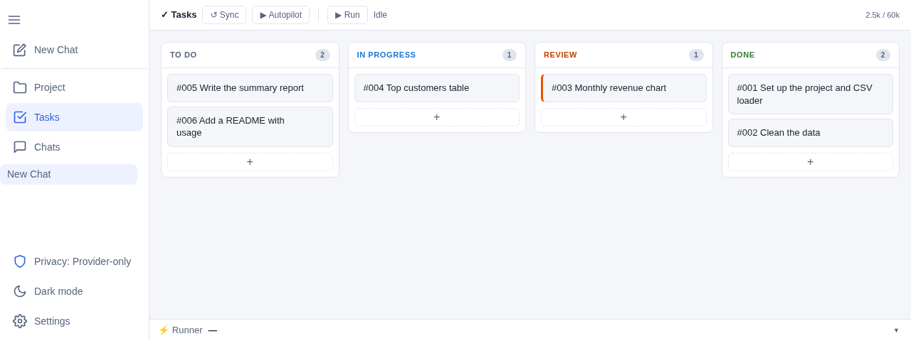

# FreeGent

**Free agentic AI for everyone.** An AI agent platform for chat and cowork, running on free AI services and available to anyone with a browser and an internet connection.



**[Open freegent.ai](https://freegent.ai)**: no install, no account. Open **Settings → Models → API Credentials**, paste a key from one provider and start chatting. [Default providers](https://freegent.ai/docs/models/providers) lists where to get free keys.

## Why FreeGent

- **Free tiers and local models.** Use the free tiers of providers such as Gemini, OpenRouter, NVIDIA and Kilo, or use your own LLM endpoints. If a model endpoint hits its rate limit mid-task, the next one takes over and the work carries on.
- **Built for diverse models.** The same reliable agent for small and large models: compacted history, repaired tool calls, output checks.
- **Runs in your browser.** Project files and code execution (JavaScript, Python, Bash) run fully inside your browser, using an in-browser file system and WASM terminal.
- **Autonomous cowork.** Drives projects from idea to completion using an integrated Kanban board to track and execute tasks.
- **Flexible.** Access freegent.ai from any browser, run locally through the CLI/TUI, or self-host the WebUI. All run the same agent harness.
- **Your data stays with you.** Keys, chats and files stay in your browser. Your chosen privacy level controls where data is sent, and by default, requests go straight from your browser to model endpoints.

## Three interfaces, one agent

| | What it is | Start it |
|---|---|---|
| **WebUI** | Chat, project files, task board and settings in the browser | [freegent.ai](https://freegent.ai), or `npm run dev` |
| **TUI** | An interactive terminal session | `freegent`, or `npm run tui` |
| **CLI** | One-off and scripted runs, for CI and pipelines | `git diff \| freegent -p "review this"` |

## Run it locally

Needs Node.js 22+.

```bash
git clone https://github.com/anttttti/FreeGent
cd FreeGent
npm install

mkdir -p ~/.config/freegent
cp .env.example ~/.config/freegent/credentials   # add at least one API key

npm run dev                                       # WebUI at http://localhost:5000
npm link                                          # optional: the `freegent` command (TUI and CLI)
```

## Documentation

The guide is at **[freegent.ai/docs](https://freegent.ai/docs/)**; the same pages are in [`docs/`](docs).

- [Overview](docs/overview.md): the design ideas and how the pieces fit
- [WebUI](docs/webui/index.md): Project, Tasks, Chats, Settings
- [Providers and models](docs/models/index.md): providers, keys, fallbacks, local models
- [Harness](docs/harness/index.md): tools, skills, MCP, compaction, checks
- [Code execution](docs/code-execution/index.md): Python, JavaScript and bash
- [Local or self-hosted](docs/local/index.md): install, TUI, CLI, your own site
- [Security](SECURITY.md) · [Contributing](docs/contributing.md)

## License

MIT. See [LICENSE](LICENSE).
