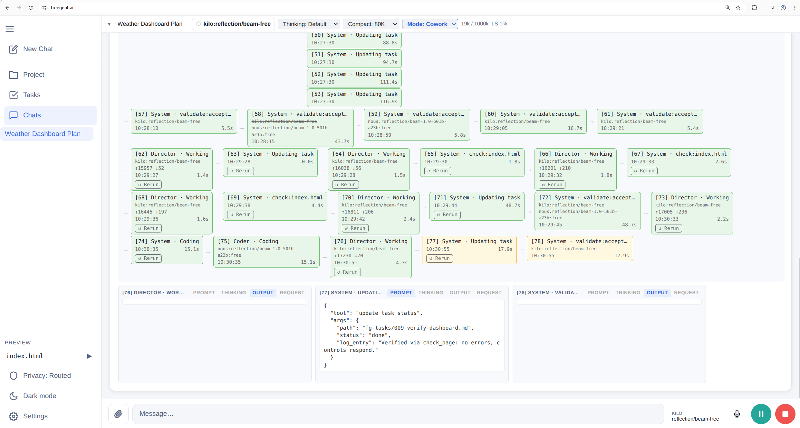

## What it looks like

## Getting started

1. Open [freegent.ai](https://freegent.ai). There is no install and no account.
2. Go to **Settings → Models → API Credentials** and paste a key for one provider. [Default providers](models/providers.md) lists where to get free ones.
3. Start a chat. The agent may call tools; each call shows as a step, and files it creates appear in **Project**. For longer jobs, switch to **Cowork** mode and start **Autopilot** on the [task board](webui/tasks.md): it works through the tasks on its own for as long as the browser tab stays open.

Keys, chats and files stay in your browser. Browsers block direct calls to most model APIs, so when you choose Routed, freegent.ai sends model requests, with your key, through a small Cloudflare proxy that forwards only to a fixed list of provider hosts and stores nothing ([details](models/proxy.md)). By default FreeGent calls providers directly from your browser and uses no Worker. The sidebar's **Privacy** button (also under **Settings → Privacy**) switches to **Routed** (through the Worker, for providers such as NVIDIA and Kilo that block browsers) or restricts FreeGent to your local network. For local models, bash on your machine, the terminal and the CLI, see [Local or self-hosted](local/index.md).

## Documentation

| Section | What it covers |
|---|---|
| [Overview](overview.md) | The design ideas and where each is explained |
| [WebUI](webui/index.md) | Project, Tasks, Chats and modes, Settings |
| [Providers and models](models/index.md) | Default providers, keys, fallbacks, retries, rotation, local models |
| [Harness](harness/index.md) | Tools, roles, skills, MCP, compaction and checks |
| [Code execution](code-execution/index.md) | Python, JavaScript and bash, in the browser or on your machine |
| [Local or self-hosted](local/index.md) | Install, TUI, CLI, LAN access, your own site and Worker |

