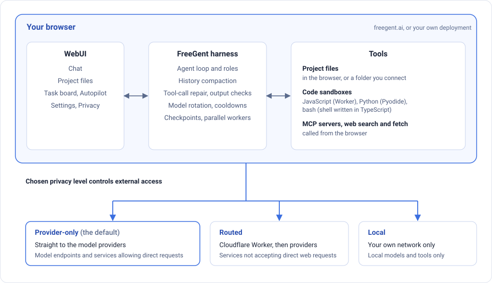

# Overview

FreeGent is an AI agent for free-tier cloud models and for models on your own machine. It reads and edits project files, runs code, searches the web and keeps a task board. Everything in its design serves one goal: stay reliable on diverse rate-limited free models.

## What sets FreeGent apart

- **It all runs in your browser.** The agent loop, the project filesystem and code execution (JavaScript, Python and bash) live in the page, isolated by the browser. No install, no account, no server of its own. See [Code execution](/code-execution/).
- **Built for free tiers.** It rotates between providers and models as quotas run out or requests fail, and ranks models with its own long-conversation test results. See [Priority, fallbacks and retries](/models/rotation).
- **Every message is a checkpoint.** Rewind removes the later messages and puts the project files back as they were; Rerun repeats a message. See [Chats](/webui/chats/).
- **A task board the agent works through.** Tasks are Markdown files; Autopilot runs them one chat per task, with quality gates between columns, for as long as the tab is open. See [Tasks](/webui/tasks).
- **You choose where requests may go.** Provider-only (the default: your browser calls providers directly, no Cloudflare Worker), Routed (through the Worker) or Local (your own network only). The sidebar's Privacy button switches between them. See [Settings → Privacy](/webui/settings#privacy).

## How the pieces fit

The agent loop, files and sandboxes run in the page; what leaves it are requests to a model, to MCP servers, and for web search and fetch. The Privacy level chooses the route: straight to the provider, through the Worker (needed for providers that browsers cannot call, such as NVIDIA and Kilo), or to your own network only. The TUI and CLI run the same agent core in Node.js, with no proxy and, optionally, real bash. See [How requests reach providers](/models/proxy) and [Code execution](/code-execution/).

## Free and local models first

FreeGent ships with default providers (Gemini, OpenRouter, NVIDIA, Kilo, Groq and others) and works with any OpenAI-compatible endpoint, including Ollama, vLLM and LM Studio. FreeGent updates the latest available models and ranks them for priority. A model that returns a rate-limit error goes on a cooldown and the next one takes over, so a free tier running out mid-task does not stop the work.

- [Default providers](/models/providers): which providers are built in and where to get keys
- [Priority, fallbacks and retries](/models/rotation): cooldowns, rotation, retries, thinking level
- [Local models](/models/local-models): connecting a model server on your machine

## Built for diverse models

The models FreeGent rotates through differ in size, context window and tool-call habits. FreeGent has a custom-built harness optimized to handle variability in model behaviour and endpoint failures:

- History is compacted at about 80K tokens, not when the window is full.
- Tool calls written as text are repaired into real calls. A step's text is checked for known failure patterns (a tool call described instead of made, narration with no action, garbled output, a missing status line), mostly by cheap pattern checks, with a model judging only when the patterns cannot decide. A failed check nudges the agent and is capped, so a check cannot loop.
- A completion gate checks that work was verified before the agent stops.
- Guidance is injected only when it applies: skills trigger on keywords, file types, tool results and failures, so the system prompt stays short.
- System prompt optimized for the conciseness, often using as few as 4k tokens.
- Mid-task rotation of available model endpoints based on quota and request failures.

See [Context and compaction](/harness/context), [Checks and approval](/harness/checks), [Skills and rules](/harness/skills) and [Fallbacks and retries](/models/rotation).

## One agent core, three interfaces

The same agent loop, tools, skills, roles and model rotation are behind every interface.

| Interface | What it is | Start it |
|---|---|---|
| **WebUI** | Chat, project files, task board and settings in the browser | [freegent.ai](https://freegent.ai), or `npm run dev` |
| **TUI** | An interactive terminal session | `freegent` (after `npm link`), or `npm run tui` |
| **CLI** | One-off and scripted runs, for CI and benchmarks | `freegent -p "…"`, or `npx tsx fg-run.ts --task "…"` |

The WebUI at freegent.ai needs no install and no account; you add API keys in Settings. It runs the agentic harness entirely inside the front-end of your browser, with its own filesystem and code execution paths isolated by the browser. To run any interface on your own machine, or host your own copy, see [Local or self-hosted](/local/). The [WebUI section](/webui/) describes the browser app.

## Code runs in sandboxes

The `execute_code` tool runs JavaScript, Python and bash. In the browser they run in an isolated frame: JavaScript in a Worker, Python in Pyodide, bash in a bash-compatible shell written in TypeScript. On your own machine, bash can run for real, optionally isolated. See [Code execution](/code-execution/).

## Project, tasks and modes

The **Project** is the agent's workspace, kept in your browser or in a folder you connect. **Tasks** are Markdown files shown on a board, and Autopilot works through them one chat per task, with quality gates between columns. **Chat** and **Cowork** modes switch the tool set between conversation and task work. See [Project](/webui/project/), [Tasks](/webui/tasks) and [Chats and modes](/webui/chats/).

## Extensible

- [Skills and rules](/harness/skills) are Markdown files you can add.
- [MCP servers](/harness/mcp) add external tools.
- [Profiles](/webui/settings#profiles) save and share model lists, tools and agent settings (never keys).

## Your data stays with you

Keys, chats, settings and project files are stored in your browser, or on your machine when you run locally. The hosted proxy forwards requests to a fixed list of provider hosts and stores nothing. See [How requests reach providers](/models/proxy) and [Where your data lives](/webui/settings#where-your-data-lives).
